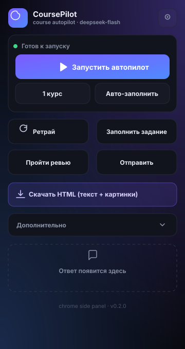
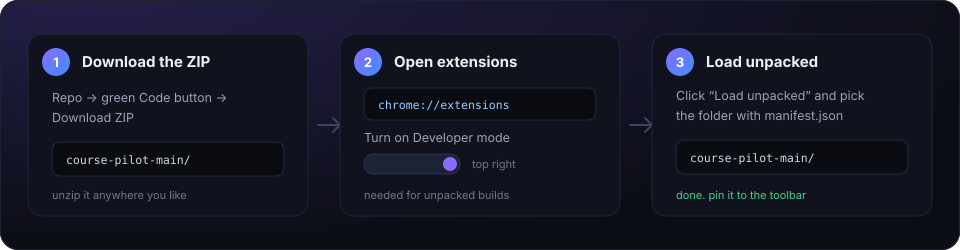

# CoursePilot

> A Chrome side panel that sits next to Coursera and does the clicking: quizzes, assignments, peer reviews. You keep the thinking.


<p align="center">
  
</p>

<p align="center">
  <a href="#install-in-60-seconds">Install</a> ·
  <a href="#features">Features</a> ·
  <a href="#what-each-button-does">Buttons</a> ·
  <a href="#tips-and-tricks">Tips</a> ·
  <a href="#troubleshooting">Troubleshooting</a> ·
  <a href="#faq">FAQ</a> ·
  <a href="#русский">Русский</a>
</p>

---

## English

### Install in 60 seconds

<p align="center">
  <a href="https://github.com/k0t2kb2s/course-pilot/archive/refs/heads/main.zip">
    
  </a>
</p>

<p align="center">
  
</p>

1. **Download and unzip.** Use the button above (or the green **Code** button → **Download ZIP**). Unzip it anywhere. The folder you need is the one with `manifest.json` inside.
2. **Open `chrome://extensions`.** Paste it into the address bar. Turn on **Developer mode** in the top right corner.
3. **Click "Load unpacked"** and pick that folder. The CoursePilot icon appears in the list.
4. **Pin it.** Click the puzzle icon in the toolbar → pin CoursePilot, so it's one click away.

Works in Chrome 114+, and in anything Chromium-based (Edge, Brave, Vivaldi, Arc). Firefox is not supported: it has no side panel API like this.

<details>
<summary>Prefer git?</summary>

```bash
git clone https://github.com/k0t2kb2s/course-pilot.git
```

Then do steps 2 to 4 above, picking the `course-pilot` folder.

</details>

**Chrome Web Store:** not published. Unpacked install only. That's also why Chrome may show a small "developer mode extensions" warning on startup. Normal for side-loaded builds.

### Add your API key

The extension needs a DeepSeek key. It is not included: no keys in the repo, no shared proxy.

1. Go to [platform.deepseek.com](https://platform.deepseek.com), create an API key, copy it.
2. Open the panel, click the gear, paste it into **Ключ DeepSeek**, hit **Сохранить**.
3. Top up your balance if the account is empty. Pay-as-you-go, no subscription.

A full course usually costs cents. Answers served from the cache cost nothing at all.

The key lives in `chrome.storage.local` on your machine and is sent only to `api.deepseek.com`. Nothing is telemetry-logged, nothing is uploaded anywhere else.

### First run

1. Open a Coursera tab with a quiz or an assignment.
2. Click the CoursePilot icon. The panel opens on the right.
3. Hit **Запустить автопилот** to walk every open Coursera tab, or **Авто-заполнить** for just the quiz in front of you.
4. Watch the status line. **Стоп** interrupts a run without closing the panel.

No account, no sign-in, no build step, no server.

### Why

Because clicking through forty quizzes is not learning. A person should read, argue, and build. The clicking is overhead, and overhead is what this removes.

### Features

| | |
| --- | --- |
| **Autopilot · all tabs** | Walks every open Coursera tab, solves each assignment, submits, retries until it passes, then does a verification pass. |
| **Autopilot · one course** | Same run, current tab only. |
| **Auto-fill** | Solves a single quiz in place, no navigation. |
| **Retry** | After a failed attempt it reads the review feedback, retakes the quiz, and changes only the wrong answers. Every option that already failed is remembered per test and never repeated. |
| **Fill assignment** | Detects the task type (quiz / rich text / file upload) and handles it. |
| **Peer review** | Fills rubric ratings and comments, then submits each pending review. |
| **Download HTML** | Exports a clean, self-contained page with the questions **and images**, so you can solve a hard task yourself. |
| **Number fields** | Numeric answers are entered as plain numbers, units stripped, formulas rejected instead of guessing. |
| **Answer cache** | Identical requests come from a local cache. No repeat API calls, no tokens. No size cap. |
| **Logs** | Every action and API call is logged locally; export the log in one click. |

### What each button does

| Button | When to press it |
| --- | --- |
| **Запустить автопилот** | You have several course tabs open and want them done in one go. |
| **Текущий курс** | You only care about the tab in front of you. |
| **Авто-заполнить** | One quiz, fill it now. Does not submit. |
| **Повторить** | You submitted, failed, and want the wrong answers fixed. |
| **Заполнить задание** | A rich-text homework or a file-upload assignment. |
| **Выполнить ревью** | You owe peer reviews and don't want to click through the rubric. |
| **Скачать HTML** | The task is too hard for the model. Export it and solve it yourself. |
| **Стоп** | Kill the current run. Answers already filled stay filled. |

### Tips and tricks

- **One tab per quiz.** Autopilot walks tabs in order, so open the week's quizzes first and let it work.
- **Wrong options ticked?** Open the gear and switch **Исключение ответов при ретрае** between **По номеру варианта** and **По тексту ответа**. One of the two always matches the course's markup.
- **Answers look stale?** A course updated its questions. Press **Очистить лог, кэш и историю**, then rerun. The cache is unlimited, so it will happily serve an old answer forever otherwise.
- **Math and symbolic tasks.** If the model keeps missing, use **Скачать HTML**: the export keeps formulas and images, so you can solve it in a notebook and paste the result.
- **Quizzes with pictures.** Images are sent to the model along with the text, so diagrams and code screenshots work.
- **Peer review needs the page open.** Navigate to *Reviews left to complete* first, then press **Выполнить ревью**.
- **Before reporting a bug**, press **Скачать лог** and attach the JSON. It makes a fix take minutes instead of days.
- **Reruns are instant.** Same page, same model, same request: the answer comes from the cache.
- **Panel width is draggable.** Drag the left edge. Chrome remembers the size.

### How it works

```
sidepanel.js ──► content.js ──► page-cleaner.js   (read + fill the DOM)
     │
     └────────► background.js ──► api.deepseek.com   (model configurable)
```

- **`page-cleaner.js`**: extracts quiz items, options, images, links and review feedback. Strips in-page AI boilerplate before anything leaves the browser.
- **`content.js`**: the bridge between the panel and the page.
- **`sidepanel.js`**: the UI and the autopilot / retry / review logic.
- **`background.js`**: API calls, image encoding, caching, retries, and a single global request queue so parallel runs don't trip rate limits.

### What's inside

```
background.js      API calls, cache, retries, request queue
content.js         page <-> panel bridge
page-cleaner.js    extract + fill the DOM
sidepanel.*        the UI and the autopilot logic
icons/             toolbar icon 16/32/48/128
tests/             node --test, 20 passing
docs/              panel and install mockups
```

### Troubleshooting

| What you see | What to do |
| --- | --- |
| **Nothing opens when I click the icon** | Chrome older than 114, or the side panel is disabled. Update Chrome, reload the extension, try again. |
| **"Не найдены вопросы теста"** | You are not on the quiz page, or the page is still loading. Open the quiz itself, wait for it to render, retry. |
| **"Отмечено 0 из N вопросов"** | Answer format did not match the markup. Switch the retry mode in settings, refresh the page, run again. |
| **"Добавь API-ключ DeepSeek"** | The key field is empty. Paste it and hit **Сохранить**. |
| **HTTP 401** | Key is wrong or revoked. Create a new one. |
| **HTTP 402 / Insufficient Balance** | Top up on the DeepSeek platform. |
| **HTTP 429** | Rate limit. Requests are queued one at a time already; wait a minute and retry. |
| **Action buttons do nothing** | Reload the extension in `chrome://extensions`, then reopen the panel. Code changes need a reload. |
| **"Редактор не найден"** | Open *My submission* manually, then press **Заполнить задание**. |
| **"Кнопка Submit не найдена"** | The page is not a quiz or assignment page. |
| **Answers repeat after a course update** | **Очистить лог, кэш и историю**, then run again. |
| **Panel looks broken after an update** | Hard reload the extension (`chrome://extensions` → reload icon), then reopen the panel. |

### FAQ

**Does it work on mobile?** No. Chrome side panels do not exist on Android or iOS.

**Do I need an API key?** Yes. The repo ships without one on purpose.

**How much does it cost?** DeepSeek is pay-as-you-go. A course is usually cents. Cached answers are free.

**Will it fix my degree?** It fixes the quiz. The degree is still on you.

**Can I use another model?** The model field takes any model id your endpoint serves. The endpoint itself is fixed to DeepSeek in this build; a provider switch is on the roadmap.

**Why are the buttons in Russian?** Because the author is.

**Why does it strip "You are a helpful AI assistant..."?** Some assessment pages inject that text to confuse assistants. The cleaner removes it before the model sees anything.

**Is my key safe?** It sits in `chrome.storage.local`, on your machine, and goes only to `api.deepseek.com`. There is no backend to leak it.

**Does it store my answers?** Locally, in the same place, so reruns are free. **Очистить лог, кэш и историю** wipes it.

**Does it learn from failed attempts?** Yes, per test. Wrong options are remembered and never offered again; correct ones are kept unchanged.

**Can I run it on two accounts?** Only one profile at a time. Use separate Chrome profiles if you need both.

### Roadmap

- [x] Autopilot across all tabs
- [x] Retry until it passes
- [x] Peer-review automation
- [x] Local answer cache
- [x] Toolbar icon and install guide
- [ ] In-video quizzes
- [ ] Provider switch in the UI
- [ ] Chrome Web Store release

### Privacy

Everything runs locally. No server, no analytics, no third-party storage. The API key lives in `chrome.storage.local` and is only sent to `api.deepseek.com`. Logs are local too and capped at the last 1000 entries.

### Limits and fair warning

- Hard symbolic and math assignments depend on the model and can still fail.
- In-video quizzes are not automated.
- Coursera changes its DOM from time to time, so selectors may need a touch-up.
- Automated completion can violate a course's honour code. That is your call, not the tool's. Use it on the boring parts and know your own rules.

### Development

No build step. Edit the files, reload the extension.

```bash
npm run check   # syntax check for every JS file
npm test        # 20 tests, node --test
```

### Contributing

Fork it, keep the diff focused, and make sure `npm run check && npm test` stays green.

### License

MIT, see [LICENSE](LICENSE).

---

## Русский

### Установка за 60 секунд

<p align="center">
  <a href="https://github.com/k0t2kb2s/course-pilot/archive/refs/heads/main.zip">
    
  </a>
</p>

<p align="center">
  
</p>

1. **Скачай и распакуй.** Кнопка выше (или зелёная **Code** → **Download ZIP**). Распаковать можно куда угодно. Нужна папка, внутри которой лежит `manifest.json`.
2. **Открой `chrome://extensions`.** Вставь в адресную строку. Справа сверху включи **Режим разработчика**.
3. **Нажми «Загрузить распакованное»** и выбери эту папку. В списке появится CoursePilot.
4. **Закрепи.** Иконка пазла на панели → закрепить CoursePilot, чтобы он был в один клик.

Работает в Chrome 114+ и в любом Chromium: Edge, Brave, Vivaldi, Arc. Firefox не поддерживается, там нет такого side panel API.

<details>
<summary>Любишь git?</summary>

```bash
git clone https://github.com/k0t2kb2s/course-pilot.git
```

Дальше шаги 2–4, выбрать папку `course-pilot`.

</details>

**Chrome Web Store:** расширение там не опубликовано, только установка из папки. Поэтому Chrome может ругаться на «расширения в режиме разработчика» при запуске. Для side-load это нормально.

### Ключ API

Расширению нужен ключ DeepSeek. В репозитории его нет: ни ключей, ни общего прокси.

1. Зайди на [platform.deepseek.com](https://platform.deepseek.com), создай ключ, скопируй.
2. Открой панель, шестерёнка, вставь в **Ключ DeepSeek**, нажми **Сохранить**.
3. Если баланс пустой — пополни. Оплата по факту, без подписки.

Один курс обычно стоит копейки. Ответы из кэша не стоят вообще ничего.

Ключ лежит в `chrome.storage.local` у тебя на машине и уходит только на `api.deepseek.com`. Никакой телеметрии и сторонних серверов.

### Первый запуск

1. Открой вкладку Coursera с тестом или заданием.
2. Нажми иконку CoursePilot. Панель откроется справа.
3. **Запустить автопилот** — пройти все открытые вкладки Coursera. **Авто-заполнить** — только тест перед тобой.
4. Следи за строкой статуса. **Стоп** прерывает прогон, панель остаётся.

Без аккаунта, без входа, без сборки, без сервера.

### Зачем

Потому что прощёлкивать сорок тестов — это не учёба. Человек должен читать, спорить и строить. Клики — накладные расходы, их инструмент и убирает.

### Возможности

| | |
| --- | --- |
| **Автопилот · все вкладки** | Проходит все открытые вкладки Coursera, решает каждое задание, отправляет, добивает ретраем до прохода и делает перепроверку. |
| **Автопилот · один курс** | То же, но только текущая вкладка. |
| **Авто-заполнить** | Решает один тест на месте, без переходов. |
| **Повторить** | После провала читает фидбек, перепроходит и меняет только неверные ответы. Каждый уже проваленный вариант запоминается для этого теста и больше не предлагается. |
| **Заполнить задание** | Определяет тип задания (квиз / rich-text / загрузка файла) и обрабатывает. |
| **Выполнить ревью** | Ставит оценки по рубрике, пишет комментарии и отправляет ревью. |
| **Скачать HTML** | Сохраняет чистую страницу с вопросами **и картинками**, чтобы решить сложное вручную. |
| **Числовые поля** | Числовые ответы вписываются числом, единицы отбрасываются, формулы не превращаются в угадайку. |
| **Кэш ответов** | Одинаковые запросы берутся из локального кэша: без повторных вызовов API и токенов. Без лимита размера. |
| **Логи** | Каждое действие и вызов API пишутся локально; лог выгружается одной кнопкой. |

### Что делает каждая кнопка

| Кнопка | Когда нажимать |
| --- | --- |
| **Запустить автопилот** | Открыто несколько курсов, нужно пройти всё разом. |
| **Текущий курс** | Нужна только вкладка перед тобой. |
| **Авто-заполнить** | Один тест, заполнить сейчас. Не отправляет. |
| **Повторить** | Отправил, провалил, исправить неверные ответы. |
| **Заполнить задание** | Домашка текстом или задание с загрузкой файла. |
| **Выполнить ревью** | Надо закрыть чужие peer review, а не кликать рубрику. |
| **Скачать HTML** | Задача слишком сложная для модели: выгрузи и реши сам. |
| **Стоп** | Остановить текущий прогон. Уже отмеченное останется. |

### Приколюшки и хитрости

- **Одна вкладка на тест.** Автопилот идёт по вкладкам по порядку: открой тесты недели и дай ему поработать.
- **Отмечает не те варианты?** В настройках переключи **Исключение ответов при ретрае** между **По номеру варианта** и **По тексту ответа**. Один из двух режимов всегда попадает в разметку курса.
- **Ответы устарели?** Курс обновил вопросы. Нажми **Очистить лог, кэш и историю** и запусти снова. Кэш безлимитный, иначе старый ответ будет возвращаться вечно.
- **Математика и символы.** Если модель стабильно мажет, жми **Скачать HTML**: в экспорте остаются формулы и картинки, реши в блокноте и вставь результат.
- **Тесты с картинками.** Изображения уходят модели вместе с текстом, так что схемы и скриншоты кода тоже работают.
- **Ревью требует открытой страницы.** Сначала зайди в *Reviews left to complete*, потом жми **Выполнить ревью**.
- **Собираешься сообщить о баге?** Нажми **Скачать лог** и приложи JSON. С ним починка занимает минуты, без него — дни.
- **Повторный прогон мгновенный.** Та же страница, та же модель, тот же запрос — ответ из кэша.
- **Ширина панели тянется.** Потяни за левый край. Chrome запомнит размер.

### Как это работает

```
sidepanel.js ──► content.js ──► page-cleaner.js   (читает и заполняет DOM)
     │
     └────────► background.js ──► api.deepseek.com   (модель настраивается)
```

- **`page-cleaner.js`**: вытаскивает вопросы, варианты, картинки, ссылки и фидбек. Вырезает встроенные «ИИ-инструкции» до того, как что-то покинет браузер.
- **`content.js`**: мост между панелью и страницей.
- **`sidepanel.js`**: интерфейс и логика автопилота / ретрая / ревью.
- **`background.js`**: вызовы API, кодирование картинок, кэш, ретраи и одна общая очередь, чтобы параллельные прогоны не ловили 429.

### Что внутри

```
background.js      вызовы API, кэш, ретраи, очередь
content.js         мост страница <-> панель
page-cleaner.js    извлечение и заполнение DOM
sidepanel.*        интерфейс и логика автопилота
icons/             иконка 16/32/48/128
tests/             node --test, 20 проходят
docs/              мокапы панели и установки
```

### Если что-то не работает

| Что видишь | Что делать |
| --- | --- |
| **По клику на иконку ничего не открывается** | Chrome старше 114 или side panel отключена. Обнови браузер, перезагрузи расширение. |
| **«Не найдены вопросы теста»** | Это не страница теста, или она ещё грузится. Открой сам тест, дождись отрисовки, повтори. |
| **«Отмечено 0 из N вопросов»** | Формат ответа не совпал с разметкой. Переключи режим ретрая в настройках, обнови страницу, запусти снова. |
| **«Добавь API-ключ DeepSeek»** | Поле ключа пустое. Вставь и нажми **Сохранить**. |
| **HTTP 401** | Ключ неверный или отозван. Создай новый. |
| **HTTP 402 / Insufficient Balance** | Пополни баланс на платформе DeepSeek. |
| **HTTP 429** | Лимит запросов. Они и так идут по одному; подожди минуту и повтори. |
| **Кнопки не реагируют** | Перезагрузи расширение в `chrome://extensions` и открой панель заново. Правки кода требуют reload. |
| **«Редактор не найден»** | Открой *My submission* вручную и нажми **Заполнить задание**. |
| **«Кнопка Submit не найдена»** | Страница не тест и не задание. |
| **Ответы повторяются после обновления курса** | **Очистить лог, кэш и историю**, потом запуск. |
| **После обновления панель выглядит сломанной** | Перезагрузи расширение (`chrome://extensions` → иконка reload) и открой панель заново. |

### Вопросы

**Работает на телефоне?** Нет. В Chrome на Android и iOS боковых панелей нет.

**Нужен ключ API?** Да. В репозитории его нет специально.

**Сколько стоит?** DeepSeek — оплата по факту. Курс обычно стоит копейки. Кэш бесплатный.

**Закроет мне диплом?** Тест закроет. Диплом сам.

**Можно другую модель?** В поле «Модель» — любой id, который обслуживает endpoint. Сам endpoint в этой сборке фиксирован на DeepSeek; переключение провайдера в планах.

**Почему кнопки на русском?** Потому что автор русский.

**Зачем вырезать «You are a helpful AI assistant…»?** Этот текст подсовывают в некоторые страницы тестов, чтобы сбить ассистента. Чистильщик убирает его до того, как модель что-то увидит.

**Ключ в безопасности?** Лежит в `chrome.storage.local`, у тебя на машине, уходит только на `api.deepseek.com`. Бэкенда, который мог бы его слить, нет.

**Ответы где-то хранятся?** Локально, там же, чтобы повторные прогоны были бесплатными. **Очистить лог, кэш и историю** всё стирает.

**Учится на ошибках?** Да, для каждого теста отдельно. Неверные варианты запоминаются и больше не повторяются, верные остаются без изменений.

**Два аккаунта одновременно?** Нет, один профиль. Нужны оба — два профиля Chrome.

### Планы

- [x] Автопилот по всем вкладкам
- [x] Ретрай до прохода
- [x] Автоматизация peer review
- [x] Локальный кэш ответов
- [x] Иконка и инструкция по установке
- [ ] In-video тесты
- [ ] Переключение провайдера в интерфейсе
- [ ] Публикация в Chrome Web Store

### Приватность

Всё локально. Ни сервера, ни аналитики, ни стороннего хранения. Ключ живёт в `chrome.storage.local` и уходит только на `api.deepseek.com`. Логи тоже локальные, хранятся последние 1000 записей.

### Ограничения и честное предупреждение

- Сложные символьные и математические задания зависят от модели и могут не пройти.
- In-video тесты не автоматизируются.
- Coursera периодически меняет DOM, селекторы могут потребовать правки.
- Автоматическое прохождение может нарушать кодекс чести курса. Это твоё решение, не решение инструмента. Используй на скучном и знай свои правила.

### Разработка

Сборки нет. Правишь файлы, перезагружаешь расширение.

```bash
npm run check   # проверка синтаксиса всех JS
npm test        # 20 тестов, node --test
```

### Участие

Форк, аккуратный дифф, и чтобы `npm run check && npm test` оставались зелёными.

### Лицензия

MIT, см. [LICENSE](LICENSE).

---

<p align="center"><sub>Built by <a href="https://obs1d1an.tech">obs1d1an</a> · MIT · no servers were harmed</sub></p>
